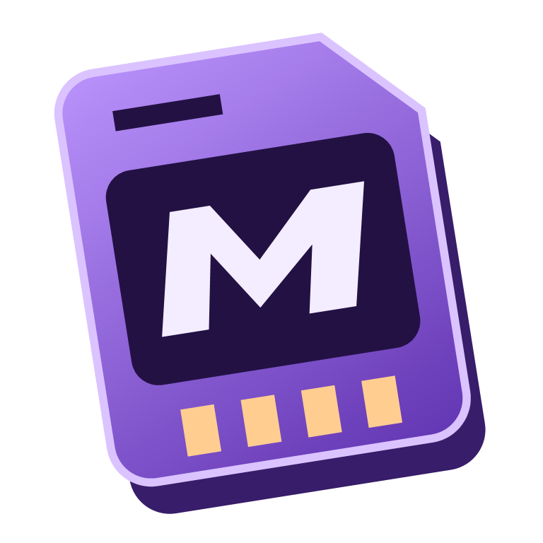

<h1 align="center">🎮 MemoryCard</h1>

<strong>Seus saves guardam suas conquistas. O MemoryCard ajuda a cuidar deles.</strong>

O **MemoryCard** é um aplicativo gratuito para Windows que ajuda você a localizar e gerenciar cópias dos seus saves. Ele foi pensado especialmente para quem utiliza o **Hydra Launcher** e deseja guardar manualmente uma cópia do progresso dos jogos no próprio computador.

🕹️ Sabe quando você quer trocar de PC, reinstalar um jogo ou simplesmente guardar o progresso antes de testar outro save? Com o MemoryCard, você pode procurar os saves reconhecidos, selecionar o jogo e criar um arquivo ZIP para manter sua cópia por perto.

O aplicativo também pode ajudar a gerenciar saves de outros jogos reconhecidos. A detecção depende do jogo e de onde ele armazena seus dados. O MemoryCard é um projeto independente, desenvolvido por **iZampirolli**, e não é afiliado ao Hydra Launcher.

> **Em desenvolvimento** — o MemoryCard está em evolução. Se você testar o aplicativo, conte como foi sua experiência e compartilhe erros, ideias e sugestões para futuras melhorias nas [Issues](https://github.com/Zampirolli87/MemoryCard/issues).

🌐 **[Conheça o site oficial](https://card.izamp.com.br)**

## 📥 Baixar

A versão atual é a **1.3.0**, para **Windows 10 ou superior de 64 bits**.

- [Baixar o instalador](https://github.com/Zampirolli87/MemoryCard/releases/download/v1.3.0/MemoryCard-Setup.exe) — instala o aplicativo e cria um atalho no menu Iniciar.
- [Baixar a versão portátil](https://github.com/Zampirolli87/MemoryCard/releases/download/v1.3.0/MemoryCard-Portable.exe) — execute diretamente de uma pasta ou pendrive.
- [Ver todas as versões](https://github.com/Zampirolli87/MemoryCard/releases)

Os executáveis da versão 1.3.0 não possuem assinatura digital.

## ✨ O que o aplicativo faz

- Procura saves de jogos reconhecidos no computador.
- Cria backups manuais em arquivos ZIP.
- Restaura backups criados pelo MemoryCard.
- Importa saves externos em formatos e estruturas compatíveis.
- Mostra o histórico de backups e permite abrir as pastas de saves e de backups.
- Oferece a opção de guardar o progresso atual antes de restaurar um backup.

A detecção e a compatibilidade dependem do jogo e da estrutura dos arquivos. Alguns jogos podem precisar de configuração adicional.

## 🚀 Como usar

1. Abra o MemoryCard e aguarde a busca de saves.
2. Selecione o jogo desejado na lista.
3. Clique em **Fazer backup** para criar uma cópia.
4. Encontre o arquivo em **Downloads\MemoryCard** ou abra a pasta pelo aplicativo.

Para recuperar um progresso, selecione o jogo e clique em **Restaurar backup**. Antes de prosseguir, confira os destinos e a opção de criar uma cópia do progresso atual.

Para usar um save obtido de outra fonte, selecione o jogo e clique em **Importar save**. A compatibilidade depende dos arquivos e do jogo. Feche o jogo antes de importar ou restaurar.

### 🐉 Para quem usa o Hydra Launcher

1. Abra o **MemoryCard** e aguarde a busca dos saves existentes no computador.
2. Procure na lista o jogo que você joga pelo Hydra e selecione o título encontrado.
3. Clique em **Fazer backup** para guardar uma cópia do progresso em ZIP.
4. Quando precisar recuperar esse progresso no mesmo ambiente reconhecido, selecione o jogo e use **Restaurar backup**.
5. Para experimentar um save externo, use **Importar save** e confira a prévia e o destino antes de confirmar.

O MemoryCard encontra saves reconhecidos, portanto o jogo precisa ter dados de save disponíveis e a localização precisa ser identificada pelo aplicativo. Uma restauração pode depender dos caminhos originais e da compatibilidade do jogo com os arquivos selecionados.

O aplicativo trabalha com arquivos locais e operações manuais. Os ZIPs ficam em `Downloads\MemoryCard` nas duas versões. Na versão portátil, as configurações ficam ao lado do executável, na pasta `MemoryCard-Dados`.

## 💬 Feedback e sugestões

Testou o MemoryCard? Seu relato ajuda a melhorar o projeto!

[Abrir uma sugestão ou relatar um problema](https://github.com/Zampirolli87/MemoryCard/issues/new)

Se estiver relatando um erro, descreva o que tentou fazer, o resultado, o nome do jogo e a versão do Windows. Evite publicar saves ou dados pessoais em uma issue pública.

## 💻 Código-fonte e compilação

O código-fonte do aplicativo está disponível neste repositório para quem quiser conhecer como o projeto funciona e se inspirar em sua construção. Ele usa C#, Windows Forms e o motor [Ludusavi](https://github.com/mtkennerly/ludusavi) 0.31.0. Os arquivos do aplicativo estão em `src/`.

Para compilar no Windows, use o script `build.ps1` em um PowerShell. Ele baixa o pacote oficial do Ludusavi e confere seu SHA-256 antes de compilar as versões instalada e portátil. Para gerar o instalador, instale também o Inno Setup 6 e informe o caminho do compilador `ISCC.exe` ao script.

O Ludusavi é distribuído sob a licença MIT. Seu texto está em [`src/Ludusavi-LICENSE.txt`](src/Ludusavi-LICENSE.txt). O código do MemoryCard ainda não possui uma licença de uso definida neste repositório.

## 💜 Créditos

MemoryCard — **desenvolvido por iZampirolli**.

